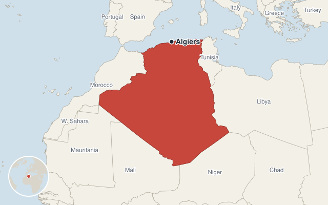
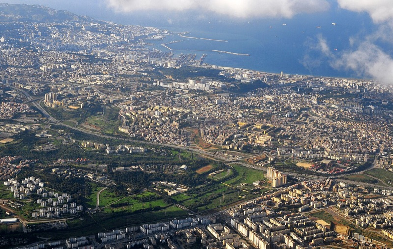

---
id    = "416bd9a2-322f-5b93-84e8-6b216028e845"
model = "Basic"
tags  = ["africa", "mediterranean", "sovereign_state", "capital"]
---

## Front

What is the capital of <b>Algeria</b>?

## Back

<b>Algiers</b>

## Extra

<i>Photo: LBM1948, CC BY-SA 4.0, via Wikimedia Commons</i>

About 4.3 million people in the urban area (2025) On the Bay of Algiers, on the Mediterranean Sea

The Arabic name, al-Jazāʾir, means "the Islands": it first referred to four islands off the western cape. A pier built in 1525 joined them to the mainland.

<a href="https://en.wikipedia.org/wiki/Algiers">Algiers on Wikipedia</a> <a href="https://en.wikipedia.org/wiki/Algeria">Algeria on Wikipedia</a>
