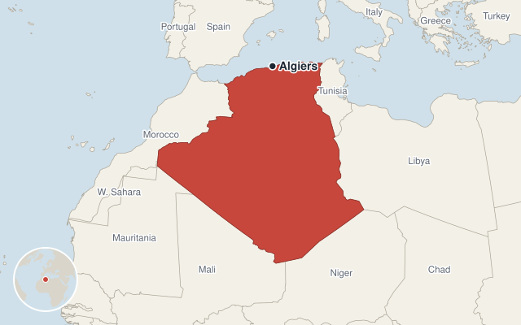

---
id    = "65c9fd17-7081-5ce8-a0b2-f535bff509c5"
model = "Basic"
tags  = ["africa", "mediterranean", "sovereign_state", "country"]
---

## Front

<b>Algiers</b> is the capital of which country or territory?

## Back

<b>Algeria</b>

## Extra

<a href="https://en.wikipedia.org/wiki/Algeria">Algeria on Wikipedia</a> <a href="https://en.wikipedia.org/wiki/Algiers">Algiers on Wikipedia</a>
