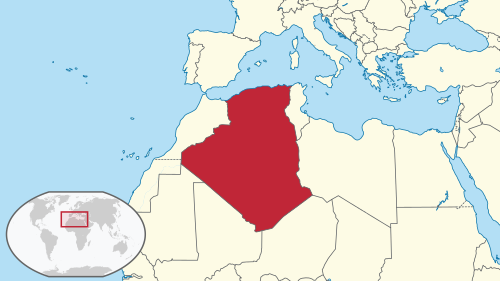
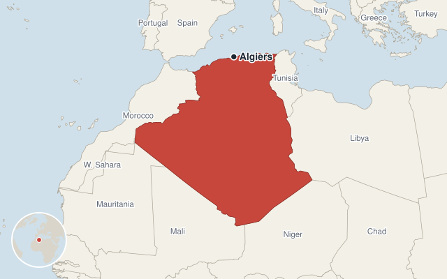

---
id    = "fec305c0-0d14-5387-b10d-65220b06588d"
model = "Basic"
tags  = ["africa", "mediterranean", "sovereign_state", "map"]
---

## Front

What is highlighted on this map?

## Back

<b>Algeria</b>

## Extra

Borders Tunisia, Libya, Niger, Mali, Mauritania, Western Sahara and Morocco Mediterranean coast to the north

The Sahara covers most of the country. Only the fertile, mountainous north, where the population is concentrated, escapes it.

<a href="https://en.wikipedia.org/wiki/Algeria">Algeria on Wikipedia</a>
