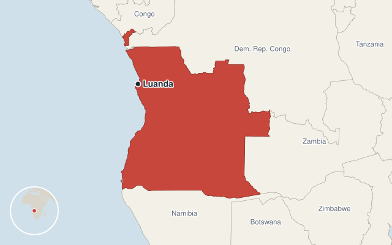
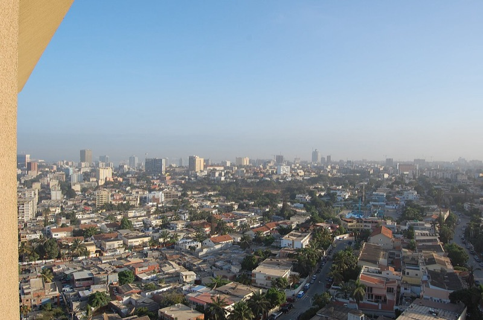

---
id    = "5aa76f86-1173-5027-a304-0cb5ddce06c4"
model = "Basic"
tags  = ["africa", "sovereign_state", "capital"]
---

## Front

What is the capital of <b>Angola</b>?

## Back

<b>Luanda</b>

## Extra

<i>Photo: Lars Rohwer, CC BY-SA 3.0, via Wikimedia Commons</i>

More than 8.8 million people (2024), a third of Angola's population Angola's chief seaport, on its northern Atlantic coast

Founded in January 1576 as São Paulo da Assunção de Loanda by the Portuguese explorer Paulo Dias de Novais. It is the most populous Portuguese-speaking national capital in the world.

<a href="https://en.wikipedia.org/wiki/Luanda">Luanda on Wikipedia</a> <a href="https://en.wikipedia.org/wiki/Angola">Angola on Wikipedia</a>
