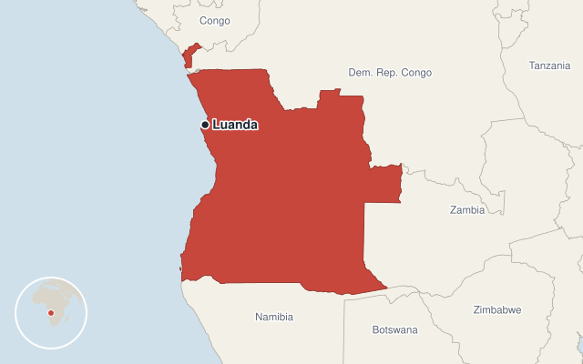

---
id    = "8b46304f-2265-5941-ab2d-f25459dc067c"
model = "Basic"
tags  = ["africa", "sovereign_state", "country"]
---

## Front

<b>Luanda</b> is the capital of which country or territory?

## Back

<b>Angola</b>

## Extra

About 36.7 million people (2023) Second-largest Portuguese-speaking country after Brazil, in area and population

It won independence from Portugal in 1975 after a long anti-colonial struggle, then fell into a civil war the same year. The war ended in 2002.

<a href="https://en.wikipedia.org/wiki/Angola">Angola on Wikipedia</a> <a href="https://en.wikipedia.org/wiki/Luanda">Luanda on Wikipedia</a>
