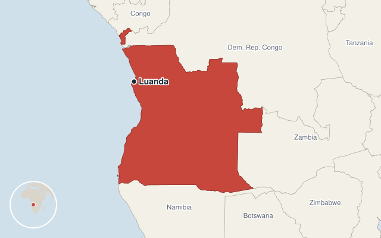

---
id    = "fbab2051-25fd-5429-87dc-c35b6dcc73e4"
model = "Basic"
tags  = ["africa", "sovereign_state", "flag"]
---

## Front

Whose flag is this?

## Back

<b>Angola</b>

## Extra

<a href="https://en.wikipedia.org/wiki/Flag_of_Angola">Flag of Angola on Wikipedia</a> <a href="https://en.wikipedia.org/wiki/Angola">Angola on Wikipedia</a>
