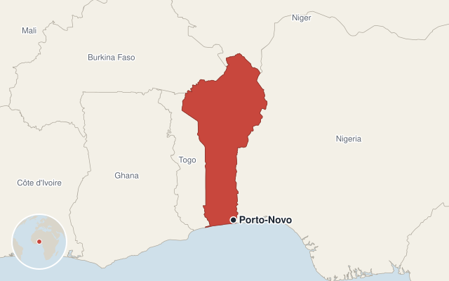
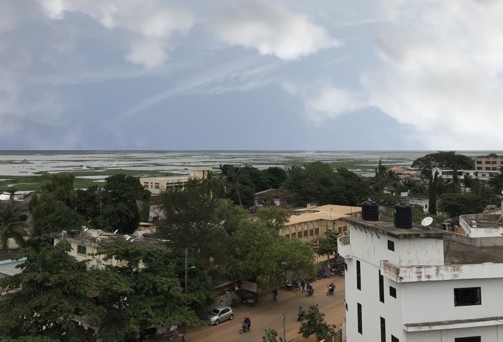

---
id    = "1819e4c5-2cde-5cb3-a5ea-52db1a41c8ef"
model = "Basic"
tags  = ["africa", "sovereign_state", "west_africa", "capital"]
---

## Front

What is the capital of <b>Benin</b>?

## Back

<b>Porto-Novo</b>

## Extra

<i>Photo: Élisée.Adad, CC BY-SA 4.0, via Wikimedia Commons</i>

About 234,000 people (2025), Benin's second-largest city On an inlet of the Gulf of Guinea

The name is Portuguese for "New Port": a Portuguese visitor named it in 1730 for its likeness to Porto. It grew as a port of the Atlantic slave trade.

While Porto-Novo is the official capital, Cotonou is the de facto seat of government.

<a href="https://en.wikipedia.org/wiki/Porto-Novo">Porto-Novo on Wikipedia</a> <a href="https://en.wikipedia.org/wiki/Benin">Benin on Wikipedia</a>
