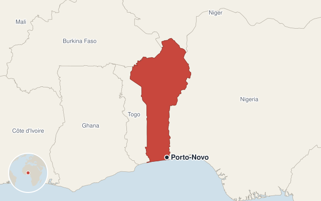

---
id    = "4c586fac-c2fa-5d19-a1d7-67e5e40467bc"
model = "Basic"
tags  = ["africa", "sovereign_state", "west_africa", "country"]
---

## Front

<b>Porto-Novo</b> is the capital of which country or territory?

## Back

<b>Benin</b>

## Extra

About 14.1 million people (2023) Independent from France since 1 August 1960

Called Dahomey until 1975, when it was renamed after the Bight of Benin. The bight itself takes its name from the Kingdom of Benin, which lay in present-day Nigeria.

While Porto-Novo is the official capital, Cotonou is the de facto seat of government.

<a href="https://en.wikipedia.org/wiki/Benin">Benin on Wikipedia</a> <a href="https://en.wikipedia.org/wiki/Porto-Novo">Porto-Novo on Wikipedia</a>
