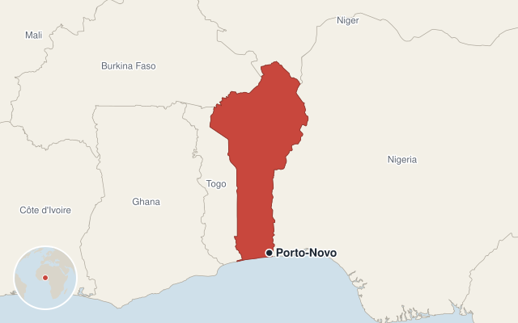

---
id    = "3ad86472-8b6f-524b-b856-e49e27d994a7"
model = "Basic"
tags  = ["africa", "sovereign_state", "west_africa", "flag"]
---

## Front

Whose flag is this?

## Back

<b>Benin</b>

## Extra

Chosen on 16 November 1959, before independence from France Replaced in 1975 by a green flag with a red star, restored after 1990

As the national anthem puts it, green is the hope of a new democracy, red the courage of the ancestors and yellow the treasures of the nation. Together they are also the Pan-African colours.

<a href="https://en.wikipedia.org/wiki/Flag_of_Benin">Flag of Benin on Wikipedia</a> <a href="https://en.wikipedia.org/wiki/Benin">Benin on Wikipedia</a>
