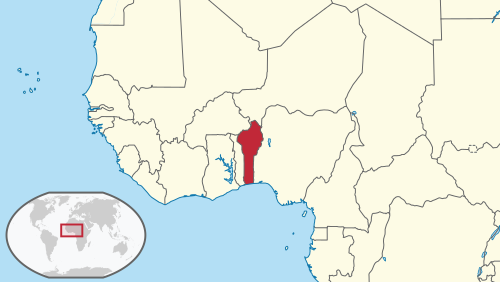

---
id    = "1649e30e-c4ee-5404-b4b1-df8b5cdde348"
model = "Basic"
tags  = ["africa", "sovereign_state", "west_africa", "map"]
---

## Front

What is highlighted on this map?

## Back

<b>Benin</b>
