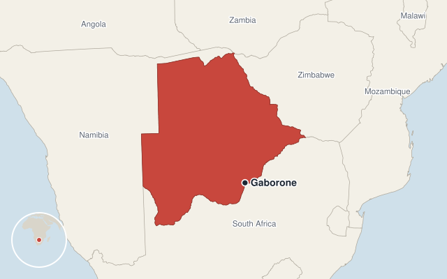
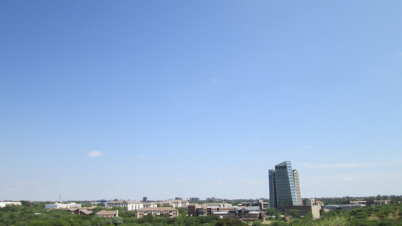

---
id    = "289b9370-fc91-5a8d-9bd8-b97a8dadbdba"
model = "Basic"
tags  = ["africa", "sovereign_state", "capital"]
---

## Front

What is the capital of <b>Botswana</b>?

## Back

<b>Gaborone</b>

## Extra

<i>Photo: Njengabenngugi, CC BY-SA 4.0, via Wikimedia Commons</i>

About 246,000 people (2022 census), roughly a tenth of Botswana Within 15 km of the South African border

Named after Chief Gaborone of the Tlokwa people. It was planned as the capital in the mid-1960s because it had no tie to any one indigenous group and was close to fresh water.

<a href="https://en.wikipedia.org/wiki/Gaborone">Gaborone on Wikipedia</a> <a href="https://en.wikipedia.org/wiki/Botswana">Botswana on Wikipedia</a>
