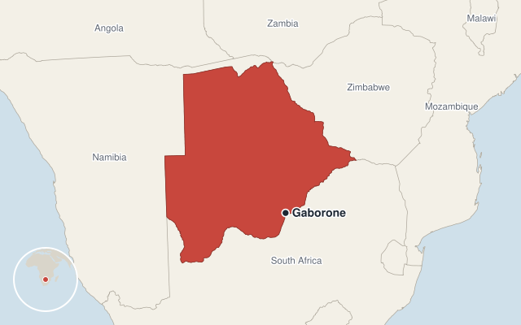
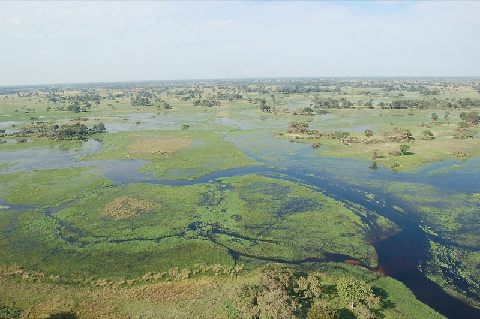

---
id    = "952cba02-d21f-5f73-85d1-c4f4b4f1c85b"
model = "Basic"
tags  = ["africa", "sovereign_state", "country"]
---

## Front

<b>Gaborone</b> is the capital of which country or territory?

## Back

<b>Botswana</b>

## Extra

<i>Photo: Joachim Huber, Joachim Huber from Switzerland, via Wikimedia Commons</i>

About 2.5 million people (2023) Landlocked, and one of the most sparsely populated countries in the world

Britain made it a protectorate called Bechuanaland in 1885. It became independent under its current name on 30 September 1966.

<a href="https://en.wikipedia.org/wiki/Botswana">Botswana on Wikipedia</a> <a href="https://en.wikipedia.org/wiki/Gaborone">Gaborone on Wikipedia</a>
