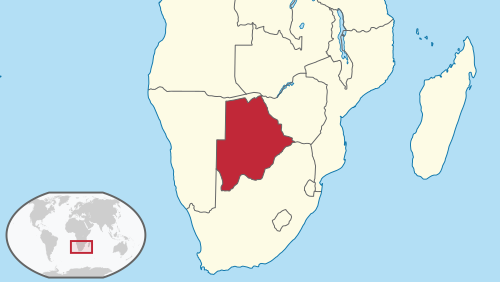
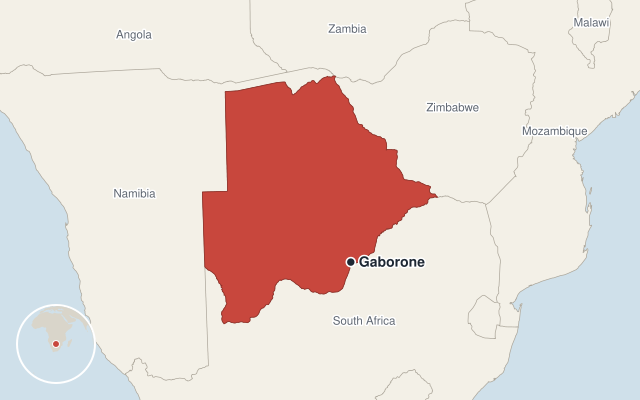

---
id    = "d1e9e324-30f6-5051-a3bc-eb0583ec0f31"
model = "Basic"
tags  = ["africa", "sovereign_state", "map"]
---

## Front

What is highlighted on this map?

## Back

<b>Botswana</b>

## Extra

<a href="https://en.wikipedia.org/wiki/Botswana">Botswana on Wikipedia</a>
