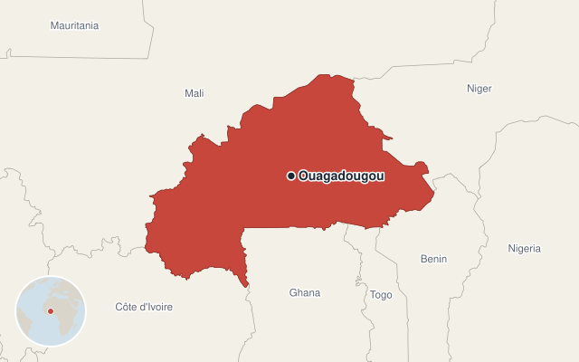
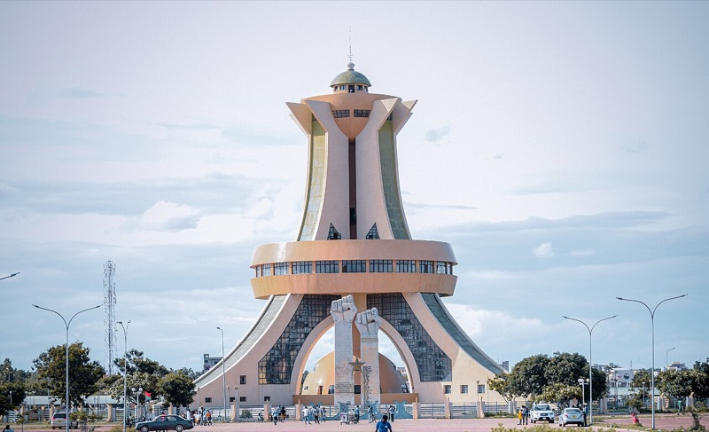

---
id    = "9d80b9cd-ce46-50a3-9b90-c48eb4761a30"
model = "Basic"
tags  = ["africa", "sovereign_state", "west_africa", "capital"]
---

## Front

What is the capital of <b>Burkina Faso</b>?

## Back

<b>Ouagadougou</b>

## Extra

<i>Photo: The black photographer, CC0, via Wikimedia Commons</i>

About 2.4 million people (2019) Home to one of West Africa's largest markets

Possibly founded as early as 1050, it became the main centre of the Mossi states around 1495. In 1919 the French colonial administration made it capital of Upper Volta.

<a href="https://en.wikipedia.org/wiki/Ouagadougou">Ouagadougou on Wikipedia</a> <a href="https://en.wikipedia.org/wiki/Burkina_Faso">Burkina Faso on Wikipedia</a>
