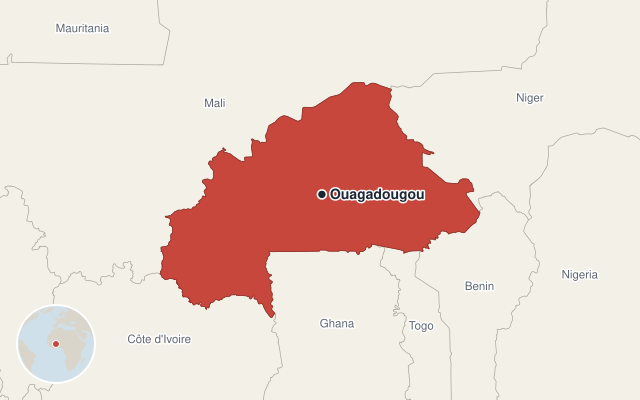

---
id    = "ccfbf9a4-593b-5f5c-ad0c-6c7b03edf02c"
model = "Basic"
tags  = ["africa", "sovereign_state", "west_africa", "country"]
---

## Front

<b>Ouagadougou</b> is the capital of which country or territory?

## Back

<b>Burkina Faso</b>

## Extra

About 23 million people (2023) Landlocked, formerly Upper Volta

Thomas Sankara renamed it on 4 August 1984. "Burkina" is Mooré for "upright", and "Faso" is Dyula for "fatherland".

<a href="https://en.wikipedia.org/wiki/Burkina_Faso">Burkina Faso on Wikipedia</a> <a href="https://en.wikipedia.org/wiki/Ouagadougou">Ouagadougou on Wikipedia</a>
