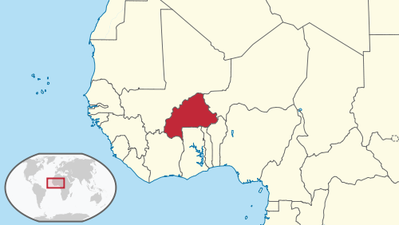

---
id    = "68cf3397-3224-580f-a131-f375532f62cd"
model = "Basic"
tags  = ["africa", "sovereign_state", "west_africa", "map"]
---

## Front

What is highlighted on this map?

## Back

<b>Burkina Faso</b>
