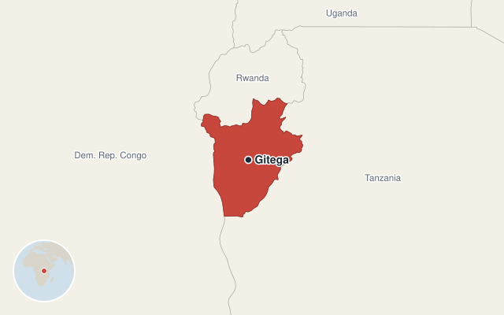
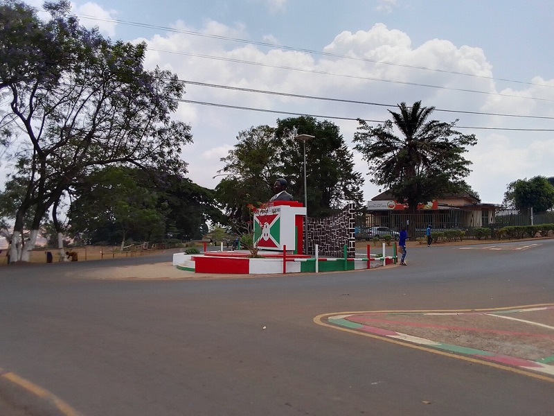

---
id    = "a761f82c-251b-5401-9b80-1ee5c28a314f"
model = "Basic"
tags  = ["africa", "east_africa", "sovereign_state", "capital"]
---

## Front

What is the capital of <b>Burundi</b>?

## Back

<b>Gitega</b>

## Extra

<i>Photo: NIHEREWENIMANA Richard, CC0, via Wikimedia Commons</i>

About 135,000 people (2020), the country's fourth-largest city On the central plateau, about 62 km east of Bujumbura

It was the seat of the Kingdom of Burundi and its kings until 1966. Parliament made it the political capital on 16 January 2019, while Bujumbura stayed the economic capital.

Official capital was moved from Bujumbura to Gitega in 2019.

<a href="https://en.wikipedia.org/wiki/Gitega">Gitega on Wikipedia</a> <a href="https://en.wikipedia.org/wiki/Burundi">Burundi on Wikipedia</a>
