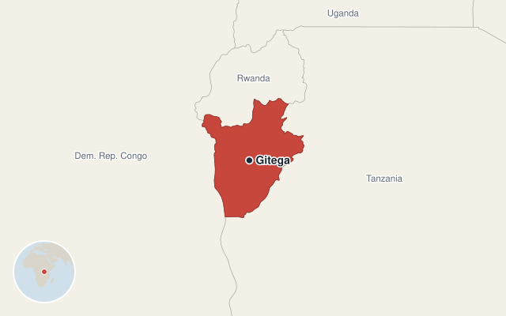

---
id    = "8a4b39f6-230c-5844-9afe-0f0ae682a5a0"
model = "Basic"
tags  = ["africa", "east_africa", "sovereign_state", "country"]
---

## Front

<b>Gitega</b> is the capital of which country or territory?

## Back

<b>Burundi</b>

## Extra

Official capital was moved from Bujumbura to Gitega in 2019.

<a href="https://en.wikipedia.org/wiki/Burundi">Burundi on Wikipedia</a> <a href="https://en.wikipedia.org/wiki/Gitega">Gitega on Wikipedia</a>
