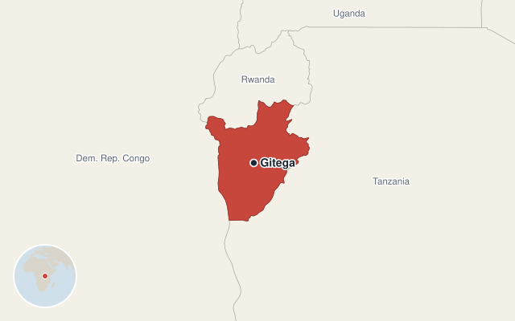

---
id    = "9fa0a5b7-c257-5ef4-8d47-8fbcfb004279"
model = "Basic"
tags  = ["africa", "east_africa", "sovereign_state", "flag"]
---

## Front

Whose flag is this?

## Back

<b>Burundi</b>

## Extra

Current design from 28 June 1967, after the monarchy was abolished in 1966 The first flag was adopted at independence on 1 July 1962

White is peace, green the hope placed on future development, red the suffering of the freedom struggle. The three stars stand for the Hutu, the Twa and the Tutsi, and for "Unity, Work and Progress".

<a href="https://en.wikipedia.org/wiki/Flag_of_Burundi">Flag of Burundi on Wikipedia</a> <a href="https://en.wikipedia.org/wiki/Burundi">Burundi on Wikipedia</a>
