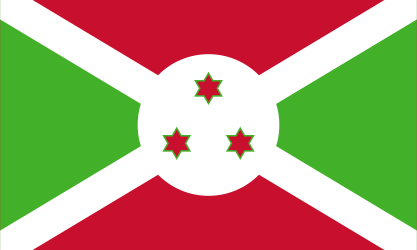

---
id    = "9fa0a5b7-c257-5ef4-8d47-8fbcfb004279"
model = "Basic"
tags  = ["africa", "east_africa", "sovereign_state", "flag"]
---

## Front

Whose flag is this?

## Back

<b>Burundi</b>

## Extra

<a href="https://en.wikipedia.org/wiki/Flag_of_Burundi">Flag of Burundi on Wikipedia</a> <a href="https://en.wikipedia.org/wiki/Burundi">Burundi on Wikipedia</a>
