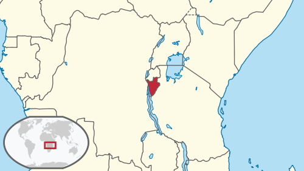
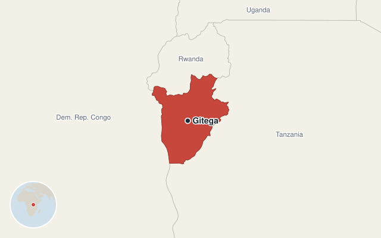

---
id    = "0c029f39-990d-5745-b85b-0c7e6e6db730"
model = "Basic"
tags  = ["africa", "east_africa", "sovereign_state", "map"]
---

## Front

What is highlighted on this map?

## Back

<b>Burundi</b>

## Extra

Borders Rwanda, Tanzania and the Democratic Republic of the Congo About 27,800 km², with Lake Tanganyika along its southwestern border

It lies where the African Great Lakes region meets southeastern Africa. It is densely populated.

<a href="https://en.wikipedia.org/wiki/Burundi">Burundi on Wikipedia</a>
