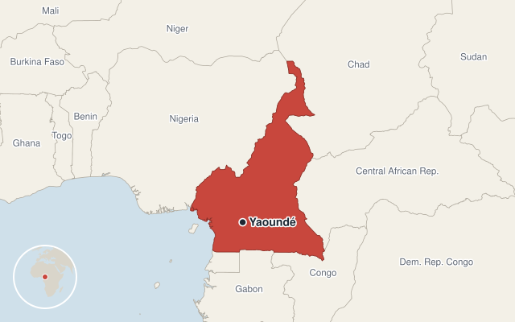
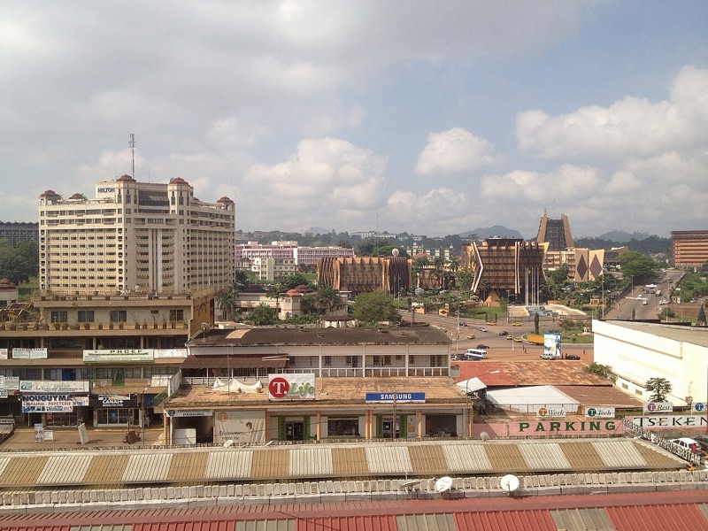

---
id    = "24acba77-1c6e-5159-94f8-5d3d9934e579"
model = "Basic"
tags  = ["africa", "sovereign_state", "capital"]
---

## Front

What is the capital of <b>Cameroon</b>?

## Back

<b>Yaoundé</b>

## Extra

<i>Photo: Bdx, CC BY-SA 4.0, via Wikimedia Commons</i>

About 2.4 million people (2012), second to the port city of Douala About 750 m above sea level, in the Centre Region

It began as a German trading base for rubber and ivory, called Jaunde after the local Yaunde or Ewondo people. France chose it as capital of its mandate in 1922.

<a href="https://en.wikipedia.org/wiki/Yaound%C3%A9">Yaoundé on Wikipedia</a> <a href="https://en.wikipedia.org/wiki/Cameroon">Cameroon on Wikipedia</a>
