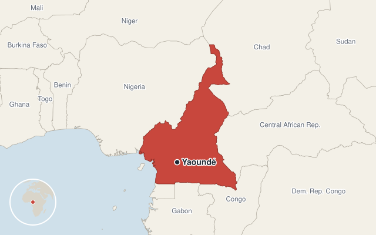

---
id    = "6c44ea49-d26f-5afd-b377-4c29853103bd"
model = "Basic"
tags  = ["africa", "sovereign_state", "country"]
---

## Front

<b>Yaoundé</b> is the capital of which country or territory?

## Back

<b>Cameroon</b>

## Extra

About 28.4 million people (2023) French and English official, among 250 native languages

Often called "Africa in miniature" for its geological, linguistic and cultural diversity. The French-administered part became independent in 1960, the British-administered part in 1961.

<a href="https://en.wikipedia.org/wiki/Cameroon">Cameroon on Wikipedia</a> <a href="https://en.wikipedia.org/wiki/Yaound%C3%A9">Yaoundé on Wikipedia</a>
