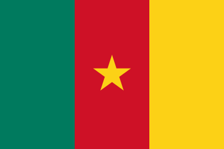
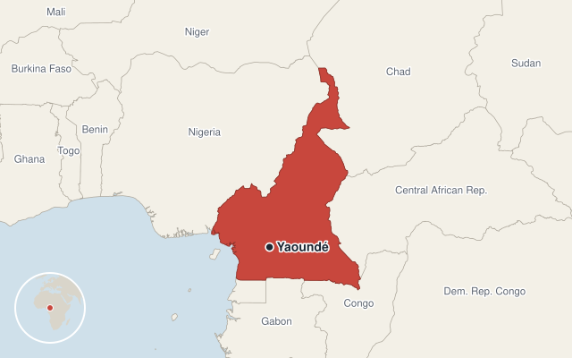

---
id    = "ee7b2ce4-3158-5457-a500-23b6e6d76f71"
model = "Basic"
tags  = ["africa", "sovereign_state", "flag"]
---

## Front

Whose flag is this?

## Back

<b>Cameroon</b>

## Extra

Plain tricolour adopted on 26 October 1957, star added on 20 May 1975 From 1961 to 1975 it had two gold stars on the green stripe

Green, red and yellow are the pan-African colours, and Cameroon was the second state to adopt them. The star on the red centre stripe is called "the star of unity".

Similar flags: Senegal (green/yellow/red, green star)

<a href="https://en.wikipedia.org/wiki/Flag_of_Cameroon">Flag of Cameroon on Wikipedia</a> <a href="https://en.wikipedia.org/wiki/Cameroon">Cameroon on Wikipedia</a>
