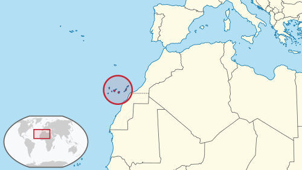
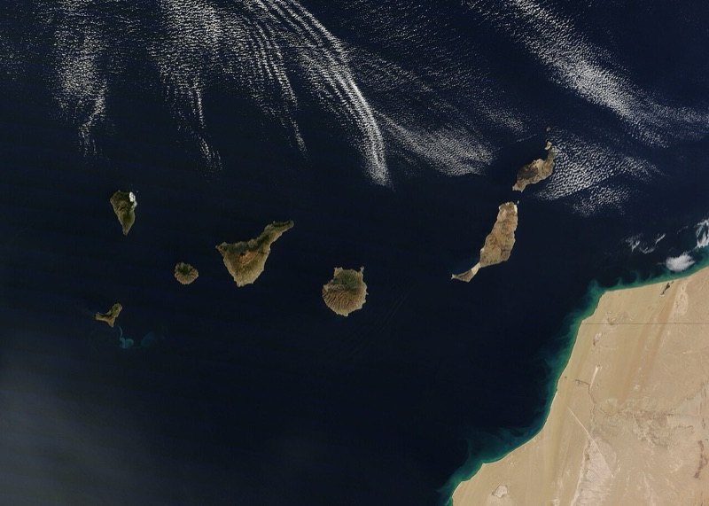

---
id    = "17664691-7b02-5656-8018-661c5225bf57"
model = "Basic"
tags  = ["africa", "map"]
---

## Front

What is highlighted on this map?

## Back

<b>Canary Islands</b>

## Extra

<i>Photo: NASA Goddard Space Flight Center from Greenbelt, MD, USA, Public domain, via Wikimedia Commons</i>

About 2.26 million people (2025) on about 7,446 km² Seven main islands, the largest being Tenerife

A Spanish autonomous community about 100 km off the northwest coast of Africa. Mount Teide on Tenerife is the highest peak in Spain.

Autonomous community of Spain.

<a href="https://en.wikipedia.org/wiki/Canary_Islands">Canary Islands on Wikipedia</a>
