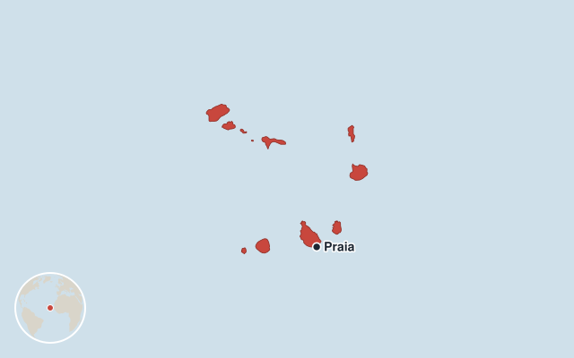
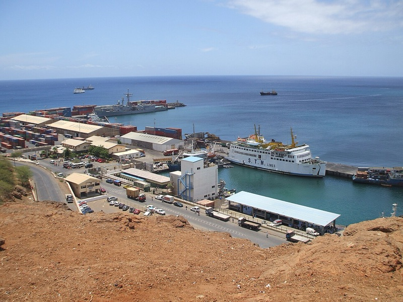

---
id    = "f90b44f9-a3eb-53fa-b8ba-8c0c8fc796bd"
model = "Basic"
tags  = ["africa", "sovereign_state", "west_africa", "capital"]
---

## Front

What is the capital of <b>Cape Verde</b>?

## Back

<b>Praia</b>

## Extra

<i>Photo: Xandu, Public domain, via Wikimedia Commons</i>

About 159,000 people (2017) On the southern coast of Santiago island

Portuguese for "beach". It grew up around a natural harbour and gradually overtook the older Cidade Velha, whose plateau site was better protected against pirates.

Also known as Cabo Verde.

<a href="https://en.wikipedia.org/wiki/Praia">Praia on Wikipedia</a> <a href="https://en.wikipedia.org/wiki/Cape_Verde">Cape Verde on Wikipedia</a>
