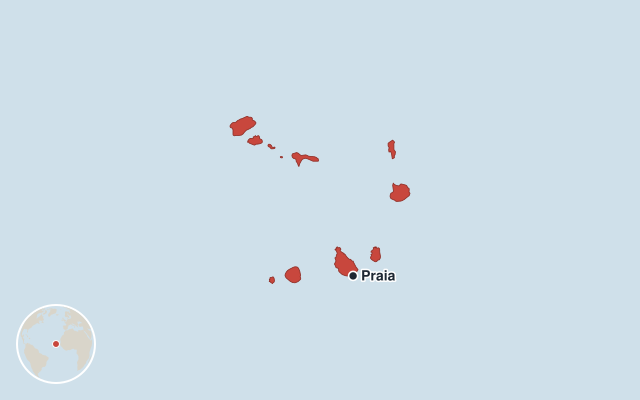
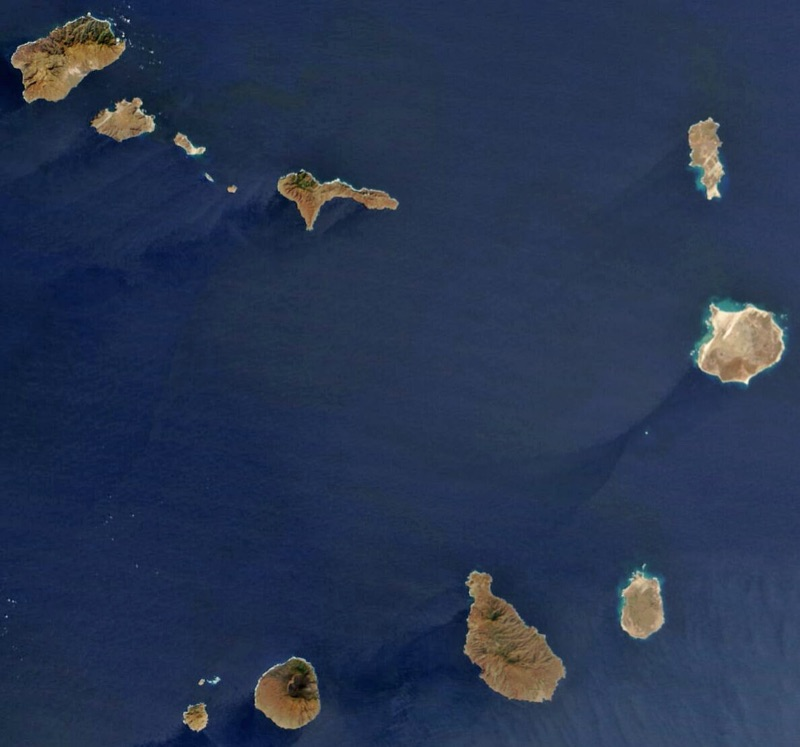

---
id    = "cf2c35b5-5e6c-5ab5-b105-1e96f1d37974"
model = "Basic"
tags  = ["africa", "sovereign_state", "west_africa", "country"]
---

## Front

<b>Praia</b> is the capital of which country or territory?

## Back

<b>Cape Verde</b>

## Extra

<i>Photo: NASA's Visible Earth, Public domain, via Wikimedia Commons</i>

About 556,000 people (2020) Ten volcanic islands, 600 to 850 km off West Africa

Uninhabited until the 15th century, when Portuguese explorers settled it. It became independent in 1975 and has been a stable democracy since the early 1990s.

Also known as Cabo Verde.

<a href="https://en.wikipedia.org/wiki/Cape_Verde">Cape Verde on Wikipedia</a> <a href="https://en.wikipedia.org/wiki/Praia">Praia on Wikipedia</a>
