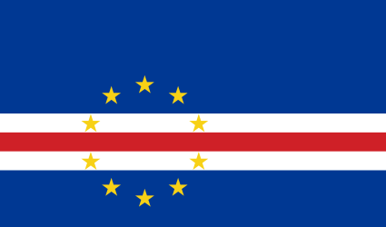

---
id    = "bbe2642f-7768-57fc-9069-f9e159ae90ab"
model = "Basic"
tags  = ["africa", "sovereign_state", "west_africa", "flag"]
---

## Front

Whose flag is this?

## Back

<b>Cape Verde</b>

## Extra

Also known as Cabo Verde.
