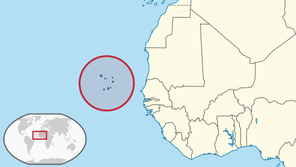
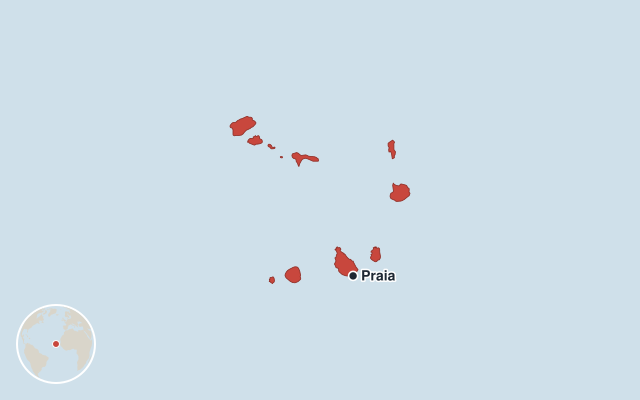

---
id    = "de641345-f0b2-567a-9a1e-769992cf956d"
model = "Basic"
tags  = ["africa", "sovereign_state", "west_africa", "map"]
---

## Front

What is highlighted on this map?

## Back

<b>Cape Verde</b>

## Extra

Also known as Cabo Verde.

<a href="https://en.wikipedia.org/wiki/Cape_Verde">Cape Verde on Wikipedia</a>
