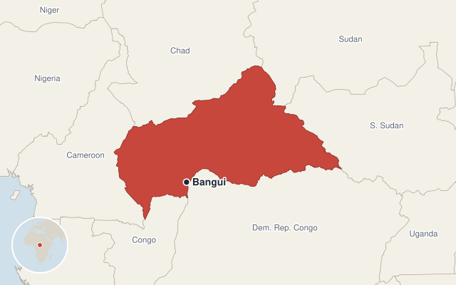
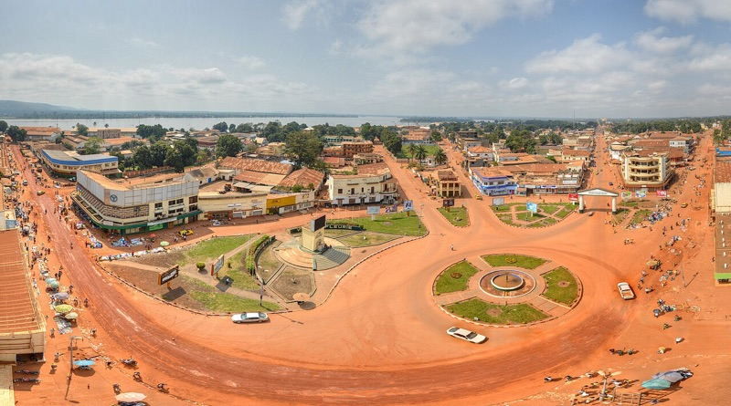

---
id    = "a4967633-eadc-5056-9f14-385c9f525e58"
model = "Basic"
tags  = ["africa", "sovereign_state", "capital"]
---

## Front

What is the capital of <b>Central African Republic</b>?

## Back

<b>Bangui</b>

## Extra

<i>Photo: Alllexxxis, CC BY-SA 4.0, via Wikimedia Commons</i>

About 889,000 people (2020) On the northern bank of the Ubangi River

Founded in 1889 as a French outpost. It is named after the river, whose own name comes from a Bobangi word for the rapids beside the settlement.

<a href="https://en.wikipedia.org/wiki/Bangui">Bangui on Wikipedia</a> <a href="https://en.wikipedia.org/wiki/Central_African_Republic">Central African Republic on Wikipedia</a>
