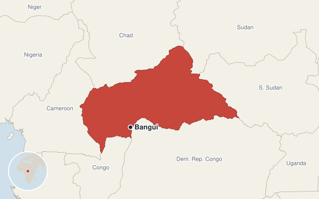

---
id    = "701b6ab6-2c80-557c-9b31-8feddac63a9c"
model = "Basic"
tags  = ["africa", "sovereign_state", "country"]
---

## Front

<b>Bangui</b> is the capital of which country or territory?

## Back

<b>Central African Republic</b>

## Extra

<a href="https://en.wikipedia.org/wiki/Central_African_Republic">Central African Republic on Wikipedia</a> <a href="https://en.wikipedia.org/wiki/Bangui">Bangui on Wikipedia</a>
