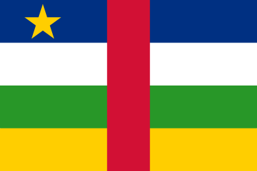
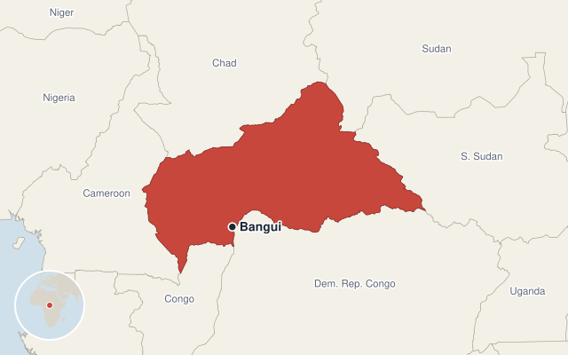

---
id    = "915f53fb-5035-5249-883d-93517599741c"
model = "Basic"
tags  = ["africa", "sovereign_state", "flag"]
---

## Front

Whose flag is this?

## Back

<b>Central African Republic</b>

## Extra

<a href="https://en.wikipedia.org/wiki/Flag_of_the_Central_African_Republic">Flag of the Central African Republic on Wikipedia</a> <a href="https://en.wikipedia.org/wiki/Central_African_Republic">Central African Republic on Wikipedia</a>
