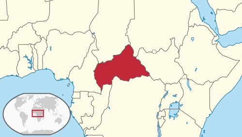

---
id    = "4a80d57c-889e-55f1-a5f9-3d7cba4580d8"
model = "Basic"
tags  = ["africa", "sovereign_state", "map"]
---

## Front

What is highlighted on this map?

## Back

<b>Central African Republic</b>
