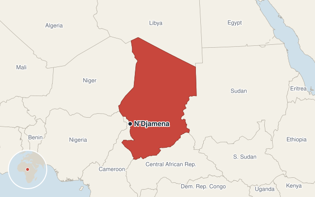

---
id    = "a73ce7c5-d8c2-5618-864b-5ab4c72a2ae1"
model = "Basic"
tags  = ["africa", "sovereign_state", "capital"]
---

## Front

What is the capital of <b>Chad</b>?

## Back

<b>N'Djamena</b>

## Extra

<a href="https://en.wikipedia.org/wiki/N'Djamena">N'Djamena on Wikipedia</a> <a href="https://en.wikipedia.org/wiki/Chad">Chad on Wikipedia</a>
