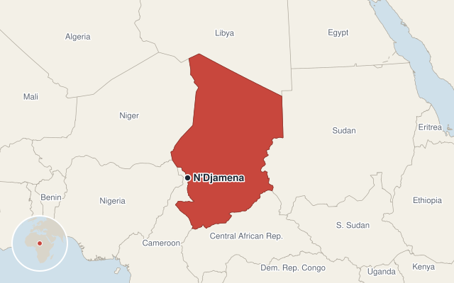

---
id    = "a243a3a9-4dfb-5956-94ca-231ce5d0d41c"
model = "Basic"
tags  = ["africa", "sovereign_state", "country"]
---

## Front

<b>N'Djamena</b> is the capital of which country or territory?

## Back

<b>Chad</b>

## Extra

<a href="https://en.wikipedia.org/wiki/Chad">Chad on Wikipedia</a> <a href="https://en.wikipedia.org/wiki/N'Djamena">N'Djamena on Wikipedia</a>
