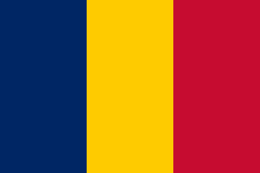

---
id    = "3941cfa3-1f5c-53f5-8458-081b20255211"
model = "Basic"
tags  = ["africa", "sovereign_state", "flag"]
---

## Front

Whose flag is this?

## Back

<b>Chad</b>

## Extra

Similar flags: Romania (slightly lighter blue)
