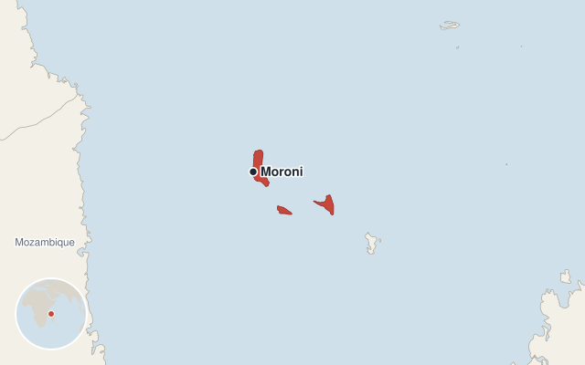

---
id    = "f7ff7f1f-02e3-58e1-8325-400b5e7614d4"
model = "Basic"
tags  = ["africa", "east_africa", "sovereign_state", "capital"]
---

## Front

What is the capital of <b>Comoros</b>?

## Back

<b>Moroni</b>

## Extra

<a href="https://en.wikipedia.org/wiki/Moroni,_Comoros">Moroni, Comoros on Wikipedia</a> <a href="https://en.wikipedia.org/wiki/Comoros">Comoros on Wikipedia</a>
