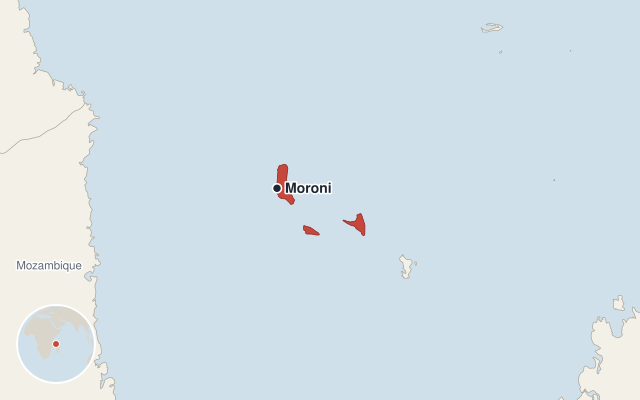

---
id    = "94194744-427b-546c-bfca-e564d008a798"
model = "Basic"
tags  = ["africa", "east_africa", "sovereign_state", "country"]
---

## Front

<b>Moroni</b> is the capital of which country or territory?

## Back

<b>Comoros</b>

## Extra

About 900,000 people (2026) Third-smallest African country, 1,659 km²

The only member of the Arab League that lies entirely in the Southern Hemisphere. It proclaimed independence from France on 6 July 1975.

<a href="https://en.wikipedia.org/wiki/Comoros">Comoros on Wikipedia</a> <a href="https://en.wikipedia.org/wiki/Moroni,_Comoros">Moroni, Comoros on Wikipedia</a>
