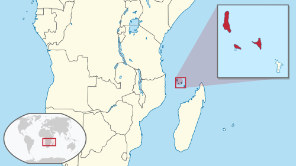
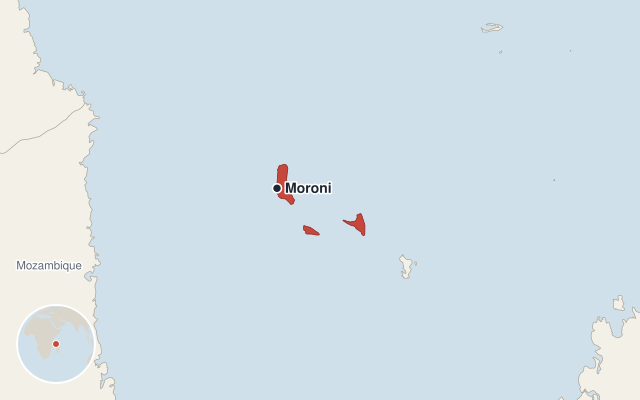

---
id    = "f7a0de6c-77bc-586b-beef-b7db50ba3cf8"
model = "Basic"
tags  = ["africa", "east_africa", "sovereign_state", "map"]
---

## Front

What is highlighted on this map?

## Back

<b>Comoros</b>

## Extra

Three main islands: Grande Comore, Anjouan and Mohéli

An archipelago at the northern end of the Mozambique Channel in the Indian Ocean. The islands are all volcanic.

<a href="https://en.wikipedia.org/wiki/Comoros">Comoros on Wikipedia</a>
