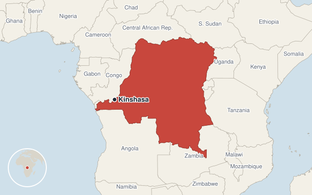

---
id    = "633e6ec3-1949-5b85-995d-be5aa7850607"
model = "Basic"
tags  = ["africa", "sovereign_state", "capital"]
---

## Front

What is the capital of <b>Democratic Republic of the Congo</b>?

## Back

<b>Kinshasa</b>

## Extra

Formerly Zaire.

<a href="https://en.wikipedia.org/wiki/Kinshasa">Kinshasa on Wikipedia</a> <a href="https://en.wikipedia.org/wiki/Democratic_Republic_of_the_Congo">Democratic Republic of the Congo on Wikipedia</a>
