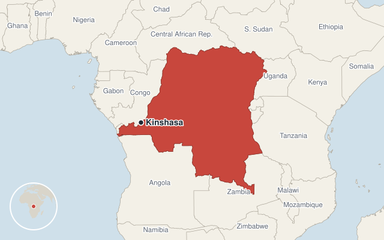

---
id    = "bc84fc17-c844-5220-9204-caade2a8f626"
model = "Basic"
tags  = ["africa", "sovereign_state", "country"]
---

## Front

<b>Kinshasa</b> is the capital of which country or territory?

## Back

<b>Democratic Republic of the Congo</b>

## Extra

Formerly Zaire.

<a href="https://en.wikipedia.org/wiki/Democratic_Republic_of_the_Congo">Democratic Republic of the Congo on Wikipedia</a> <a href="https://en.wikipedia.org/wiki/Kinshasa">Kinshasa on Wikipedia</a>
