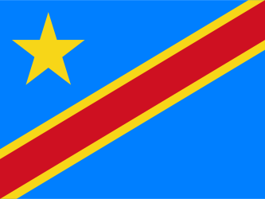
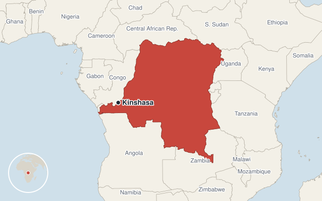

---
id    = "fa2f9e5d-849c-545f-a34c-cf86baacc167"
model = "Basic"
tags  = ["africa", "sovereign_state", "flag"]
---

## Front

Whose flag is this?

## Back

<b>Democratic Republic of the Congo</b>

## Extra

Formerly Zaire.

<a href="https://en.wikipedia.org/wiki/Flag_of_the_Democratic_Republic_of_the_Congo">Flag of the Democratic Republic of the Congo on Wikipedia</a> <a href="https://en.wikipedia.org/wiki/Democratic_Republic_of_the_Congo">Democratic Republic of the Congo on Wikipedia</a>
