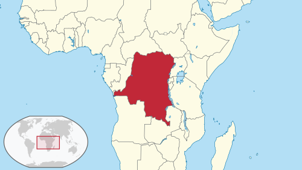

---
id    = "3cbeb38e-ad4d-5763-8e69-a6cb5720afb8"
model = "Basic"
tags  = ["africa", "sovereign_state", "map"]
---

## Front

What is highlighted on this map?

## Back

<b>Democratic Republic of the Congo</b>

## Extra

Formerly Zaire.
