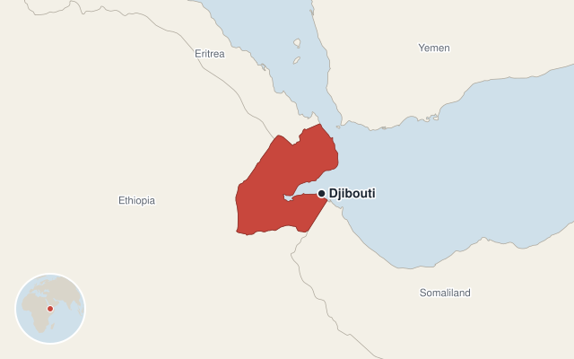

---
id    = "ccaab0c4-c872-5d04-9120-0dcb03b4e48d"
model = "Basic"
tags  = ["africa", "east_africa", "sovereign_state", "capital"]
---

## Front

What is the capital of <b>Djibouti</b>?

## Back

<b>Djibouti</b>

## Extra

About 604,000 people (2018) On the Gulf of Tadjoura

Founded in 1888 by the French, on land leased from the ruling Somali and Afar sultans. It served as the capital of French Somaliland and then of the French Territory of the Afars and Issas.

<a href="https://en.wikipedia.org/wiki/Djibouti_City">Djibouti City on Wikipedia</a> <a href="https://en.wikipedia.org/wiki/Djibouti">Djibouti on Wikipedia</a>
