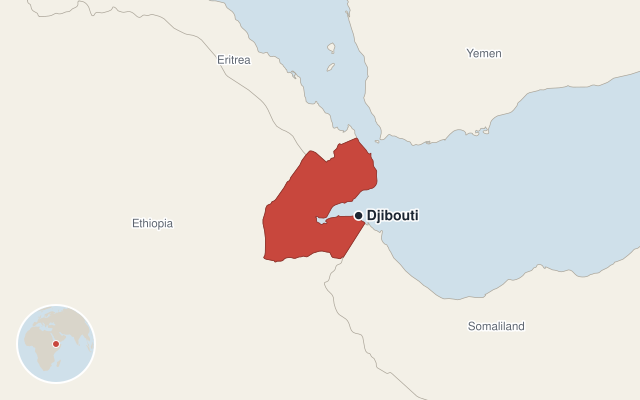
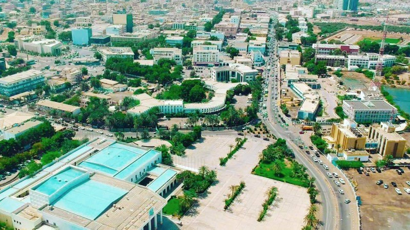

---
id    = "02582094-aeb6-5c1e-9e43-f4b2c1160d45"
model = "Basic"
tags  = ["africa", "east_africa", "sovereign_state", "country"]
---

## Front

<b>Djibouti</b> is the capital of which country or territory?

## Back

<b>Djibouti</b>

## Extra

<i>Photo: Skilla1st, CC BY-SA 4.0, via Wikimedia Commons</i>

About 1.07 million people (2024 census) The smallest population in mainland Africa

The republic is named after its capital. It voted for independence in 1977, a decade after being renamed the French Territory of the Afars and the Issas.

<a href="https://en.wikipedia.org/wiki/Djibouti">Djibouti on Wikipedia</a> <a href="https://en.wikipedia.org/wiki/Djibouti_City">Djibouti City on Wikipedia</a>
