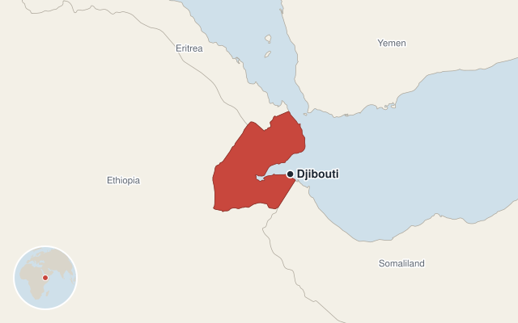

---
id    = "ffb2b400-98a4-544d-8d1a-4e6c3cdda1cc"
model = "Basic"
tags  = ["africa", "east_africa", "sovereign_state", "map"]
---

## Front

What is highlighted on this map?

## Back

<b>Djibouti</b>

## Extra

<i>Photo: Skilla1st, CC BY-SA 4.0, via Wikimedia Commons</i>

Borders Eritrea, Ethiopia and Somalia About 23,200 km²

It looks out on the Red Sea and the Gulf of Aden. Its railroad to Dire Dawa, later extended to Addis Ababa, made its port the main outlet for southern Ethiopia.

<a href="https://en.wikipedia.org/wiki/Djibouti">Djibouti on Wikipedia</a>
