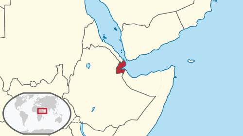

---
id    = "ffb2b400-98a4-544d-8d1a-4e6c3cdda1cc"
model = "Basic"
tags  = ["africa", "east_africa", "sovereign_state", "map"]
---

## Front

What is highlighted on this map?

## Back

<b>Djibouti</b>
