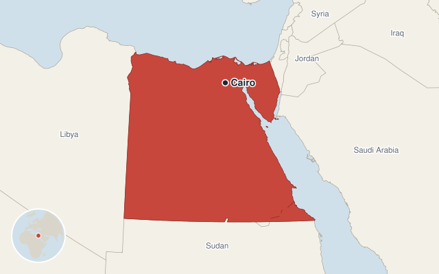

---
id    = "6818f543-e419-587e-b68b-c9c91ab06e5a"
model = "Basic"
tags  = ["africa", "mediterranean", "middle_east", "sovereign_state", "capital"]
---

## Front

What is the capital of <b>Egypt</b>?

## Back

<b>Cairo</b>

## Extra

<a href="https://en.wikipedia.org/wiki/Cairo">Cairo on Wikipedia</a> <a href="https://en.wikipedia.org/wiki/Egypt">Egypt on Wikipedia</a>
