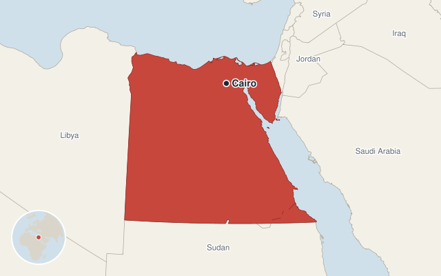

---
id    = "09f9436a-6474-5cec-88fc-0d6df4320cd0"
model = "Basic"
tags  = ["africa", "mediterranean", "middle_east", "sovereign_state", "country"]
---

## Front

<b>Cairo</b> is the capital of which country or territory?

## Back

<b>Egypt</b>

## Extra

<a href="https://en.wikipedia.org/wiki/Egypt">Egypt on Wikipedia</a> <a href="https://en.wikipedia.org/wiki/Cairo">Cairo on Wikipedia</a>
