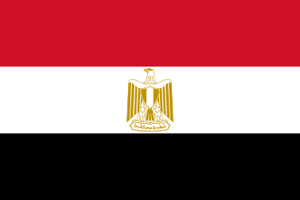
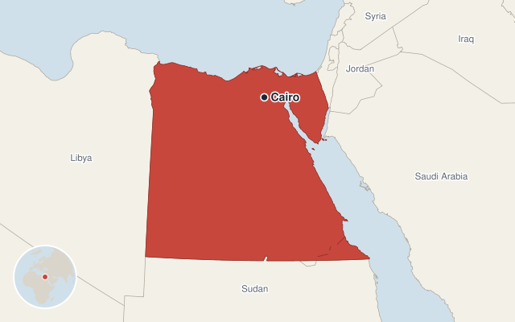

---
id    = "8fc8e287-8d69-56d5-84bb-bcc9d00a0e5d"
model = "Basic"
tags  = ["africa", "mediterranean", "middle_east", "sovereign_state", "flag"]
---

## Front

Whose flag is this?

## Back

<b>Egypt</b>

## Extra

Adopted on 4 October 1984

Red for the blood shed against colonisation, white for purity and black for darkness overcome, from the 1952 revolution. The eagle in the centre is the eagle of Saladin.

Similar flags: Iraq (text instead of emblem), Yemen (no emblem)

<a href="https://en.wikipedia.org/wiki/Flag_of_Egypt">Flag of Egypt on Wikipedia</a> <a href="https://en.wikipedia.org/wiki/Egypt">Egypt on Wikipedia</a>
